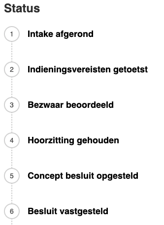
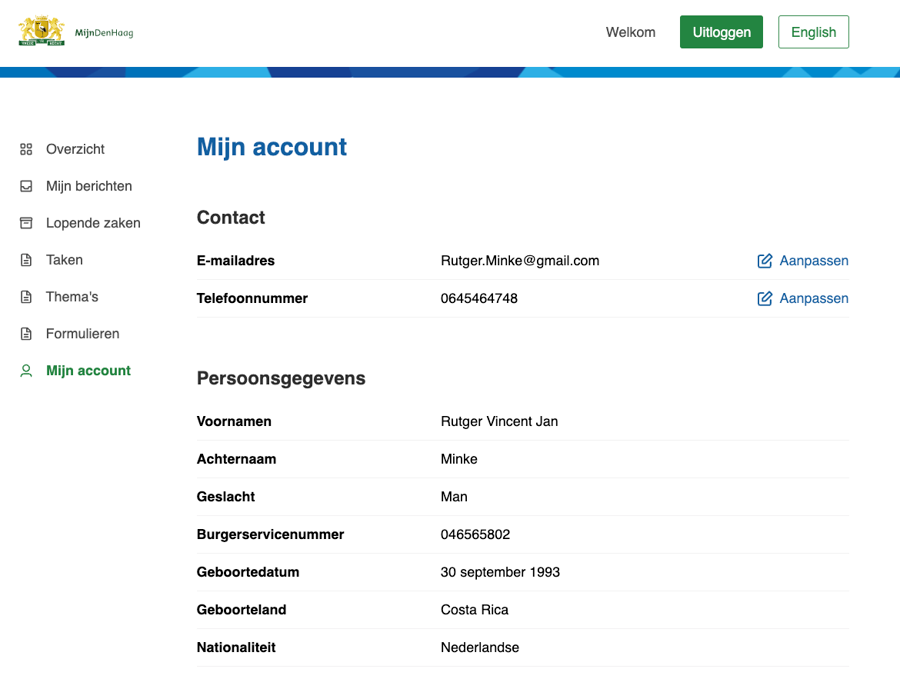

# Wat is NL Portal

NL Portal is een open source "Mijn Omgeving" voor gemeentelijke en andere overheden. Inwoners en
bedrijven kunnen hierop op een veilige manier inloggen om informatie te vinden die voor hen relevant
is.

Zo kun je:

- je persoonlijke gegevens en adresgegevens raadplegen;
- producten en diensten inzien die je bij de gemeente afneemt,

op één centrale plek, waar je 24/7 terecht kunt. Een video van de lancering van het project legt de
achtergrond uit: [vimeo.com/545567338](https://vimeo.com/545567338).

## Productvisie

Het heeft drie doelen, voor drie doelgroepen:

1. Gemak voor burgers en ondernemers.
2. Efficiëntie in de uitvoering voor overheden.
3. Voldoen aan wet- en regelgeving voor beleidsmakers.

**Gemak voor burgers en ondernemers.** We zijn gewend geraakt aan het gemak van online diensten. Een
bestelling die vandaag wordt geplaatst en morgen of zelfs vandaag al wordt geleverd, is nu de norm.
Burgers en ondernemers verwachten dezelfde efficiëntie van de overheid. NL Portal helpt hierbij door
eenvoudig online aanvragen te kunnen indienen, inzicht te hebben in de afhandeling, toegang te hebben
tot producten en diensten online en snelle levering te ervaren.

**Efficiëntie in de uitvoering voor overheden.** Overheden hebben een enorme informatiestroom te
verwerken. Dat moet sneller, met minder fouten en met minder mensen. Door automatisering kan een deel
van de informatiestroom geautomatiseerd verwerkt worden, waardoor tijd vrijkomt voor burgers en
ondernemers die persoonlijke aandacht verdienen.

NL Portal zorgt voor gestandaardiseerde digitale communicatie met burgers en ondernemers. De
verwerking van data wordt daardoor vereenvoudigd: kwaliteit in = kwaliteit uit. NL Portal volgt de
standaarden vanuit het Common Ground-project "Samenwerkende Portalen" — elk backoffice-systeem dat
deze standaarden volgt kan communiceren via NL Portal.

**Voldoen aan wet- en regelgeving voor beleidsmakers.** De wet- en regelgeving stelt hogere eisen aan
digitale diensten van overheidsinstellingen: toegankelijkheid, beveiliging, omgang met
persoonsgegevens, auditing, taalgebruik, data-integriteit, beschikbaarheid en snelheid (BIO, ISO,
AVG, WCAG, DigiD-assessment). NL Portal heeft tot doel "uit de doos" technisch aan deze eisen te
voldoen.

NL Portal heeft de volgende uitgangspunten:

- Open standaarden, open source licentie EUPL 1.2;
- Compatibel met diverse formulierapplicaties;
- Frontend UI gebaseerd op [NL Design System](https://nldesignsystem.nl/);
- Voldoet aan alle web toegankelijkheidsrichtlijnen (WCAG);
- Onafhankelijk van proces- of zaaksysteem;
- Horizontaal schaalbaar.

## Functionaliteiten

Op dit moment kent NL Portal de volgende functionaliteiten:

- **Koppeling met DigiD en eHerkenning** — vertrouwde systemen voor gebruikers, verhoogt de
  beveiliging door betrouwbare identiteitsverificatie, en biedt gemak doordat veel mensen al een
  DigiD hebben.
- **Bezoekers kunnen nieuwe zaken aanmaken** — inwoners en bedrijven kunnen via dit proces de start
  van een nieuwe zaak initiëren.
- **Bezoekers kunnen altijd de actuele status van hun zaken zien** via een track-and-trace-service.
  Deze service is vooral gericht op het bieden van inzicht in gegevens en minder op interactie.

  

- **Bezoekers kunnen taken krijgen in NL Portal** — hiermee kunnen inwoners direct zelf zaken regelen
  bij de gemeente. Deze service laat acties zien die nog door een inwoner of medewerker moeten worden
  uitgevoerd.
- **Bezoekers kunnen bestanden downloaden** die gekoppeld zijn aan hun zaak, bijvoorbeeld
  besluitdocumenten.
- **Bezoekers hebben een profielpagina**, die kan koppelen met HaalCentraal om de informatie uit de
  basisadministratie te tonen.

  

## Volledige architectuur

Dit is een vereenvoudigde, platte-taaluitleg. Voor de volledige technische architectuur, zie de
arc42-hoofdstukken, te beginnen bij [1. Inleiding en doelen](./arc42/01-inleiding-en-doelen).
