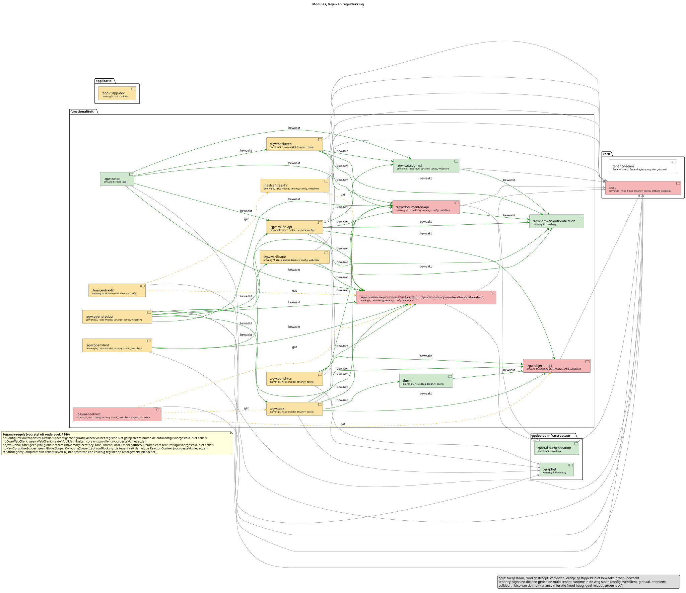
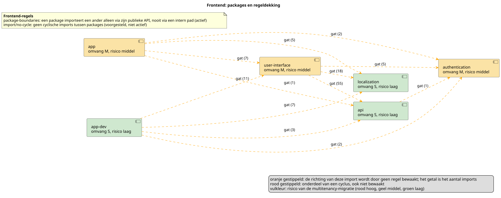

# Regeldekking en multitenancy-impact

Dit diagram laat zien hoe de backend is opgebouwd (Gradle-modules per laag), welke afhankelijkheden de
ArchUnit-regels bewaken en waar geen regel dekking geeft. Het wordt gegenereerd uit de bytecode, dus het
veroudert niet: een test faalt als het gecommitte diagram niet meer klopt met de code.

## Frontend

De frontend wordt nauwelijks bewaakt op richting. ESLint `package-boundaries` regelt alleen *hoe* een package een
ander importeert (via de publieke API, nooit via een intern pad). Geen enkele regel zegt welk package van welk
package mag afhangen, of dat cycli verboden zijn. Daarom is elke pijl een gat (oranje, met het aantal imports);
een pijl die deel is van een cyclus is rood. De regel `import/no-cycle` staat als "voorgesteld, niet actief" en
springt vanzelf naar "actief" zodra hij in de ESLint-configuratie staat. De bedoelde gelaagdheid tussen de
packages is bewust niet vastgelegd.

Omvang en risico komen uit `docs/tenancy-baseline-frontend.json` (voorlopig, uit onderzoek #200). Een package
zonder regel daar, of een regel voor een package die niet meer bestaat, laat de test in
`scripts/generate-frontend-diagram.test.mjs` falen.

## Backend: zo lees je het diagram

**Pijlen** (afhankelijkheden tussen modules):

| Pijl | Betekenis |
| --- | --- |
| grijs | Toegestaan: de afhankelijkheid wijst naar een lagere laag, zoals bedoeld. |
| groen, "bewaakt" | Beide modules vallen onder de cyclusregel (alle `zgw`-modules en `form`); een wederzijdse afhankelijkheid wordt gevangen. |
| oranje gestippeld, "gat" | Geen enkele regel bewaakt deze afhankelijkheid: de richting kan omslaan of er kan een cyclus ontstaan zonder dat een test faalt. |
| rood gestreept, "verboden" | Een regel verbiedt deze afhankelijkheid. Komt hij voor, dan faalt de build. |

**Modules**: onder de naam staan omvang (S/M/L) en risico van de multitenancy-migratie, met de vulkleur als
risico (rood hoog, geel middel, groen laag), plus de gedetecteerde signalen:

| Signaal | Betekenis |
| --- | --- |
| `config` | Een `@ConfigurationProperties`-singleton wordt buiten de autoconfig gebruikt; per tenant is een register nodig. |
| `webclient` | De module bouwt zelf een `WebClient`; hij hoort in de gedeelde client van de tenant. |
| `globaal` | JVM-globale toestand (`ThreadLocal`, `InMemorySecretKeyStore`, `OpenFeatureAPI`, `GlobalScope`). |
| `anoniem` | Een REST-endpoint onder `/api/public`: zonder token komt de tenant alleen uit het host-domein. |

De knoop `tenancy-seam` in de kern is de nog niet gebouwde tenancy-laag (`TenantContext`, `TenantRegistry`). De
notitie eronder toont de vijf regels die het multitenancy-onderzoek (#146) voorstelt. Een regel staat als
"voorgesteld, niet actief" tot `ArchitectureRules` een methode met die naam krijgt; hij springt dan vanzelf naar
"actief".

## Hoe houd je het actueel

| Taak | Wat |
| --- | --- |
| `mise run arch:diagram` | Genereert `modules.puml` (backend) en `frontend.puml` uit de code, onder `site/architectuur/img/plantuml/`. |
| `mise run arch:diagram:render` | Rendert beide `.puml`-bestanden naar `.svg` (Docker, `plantuml/plantuml`). |
| `mise run arch-check` | Draait de ArchUnit-tests, inclusief de controle dat het backend-diagram en de baseline actueel zijn. |
| `node --test "scripts/**/*.test.mjs"` | De scripttests (ook in CI), inclusief de controle dat het frontend-diagram en zijn baseline actueel zijn. |

Commit na een wijziging het `.puml` en de `.svg` samen.

### De tenancy-baseline

Omvang, risico en de reden van elk bekend signaal staan in `docs/tenancy-baseline.yaml`. Alleen het oordeel
staat daar; de signalen zelf worden elke run uit de code afgeleid. De test faalt in beide richtingen:

- een **nieuw signaal** dat niet in de baseline staat: los het op, of voeg het met reden toe;
- een **baseline-signaal dat uit de code verdween**: haal het uit het bestand, de module is dan gemigreerd;
- een module zonder regel in de baseline, of een regel voor een module die niet meer bestaat.

De huidige waarden zijn voorlopig, overgenomen uit onderzoek #146, en nog niet door de maintainer beoordeeld.

## Wat dit diagram niet laat zien

- De frontend per package, niet per bestand; de bedoelde gelaagdheid tussen de packages is bewust niet vastgelegd.
- Afhankelijkheden op moduleniveau, niet per package binnen een module.
- Of een regel de afhankelijkheid ook echt tegenhoudt: dat bewijst `ArchitectureRulesProofTest`.

Zie [#386](https://github.com/pinkroccade/nl-portal/issues/386) voor het ontwerp en de vervolgstappen.
